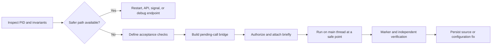

# Python Hot Patch Skill

<p align="center">
  
</p>

<p align="center">
  
  
  
  
  
</p>

<p align="center">
  <a href="./README.md">English</a> · <a href="./README_zh.md">简体中文</a>
</p>

An Agent Skill for Codex and Claude Code that guides **safe hot-patching of a live CPython process**. It is intended for situations where restarting would destroy valuable in-memory state and the required change can be reduced to a small mutation of existing Python objects or methods.

The skill uses `gdb`, a temporary shared library, and `Py_AddPendingCall`. The debugger only queues a callback; the actual Python mutation runs later on the interpreter's main thread at a safe point.

| Preserve | Schedule | Verify | Persist |
|:--|:--|:--|:--|
| Keep expensive in-memory state alive | Queue Python work with `Py_AddPendingCall` | Check behavior independently of the marker | Apply the equivalent source or configuration fix |

## How it works



## When to use it

- Restarting would discard expensive in-memory state.
- The target is well-defined and the change is a narrow mutation of an existing Python object or method.
- Acceptance checks can be defined before the operation, including process survival, semantic state, throughput, or concurrency.
- The equivalent source or configuration change can be persisted afterward so the fix survives a restart.

Prefer a restart, supported control API, signal handler, or existing debug endpoint when any of the following applies:

- The change touches interpreter internals, object layouts, or native extension state.
- The change affects model structure, optimizer state, or invariants spanning multiple threads.
- The target cannot be identified uniquely, its old state cannot be confirmed, or the outcome cannot be verified reliably.

## Core safety constraints

> [!CAUTION]
> Hot-patching is a last-resort operational technique. Prefer a restart or supported control surface whenever one is available.

- Obtain explicit authorization immediately before every process attachment.
- Never call `PyRun_SimpleString` directly from an arbitrary stopped thread. That thread may not hold the GIL, which can deadlock or corrupt the interpreter.
- Make the patch idempotent and write a marker containing the old and new values.
- A zero return value from `Py_AddPendingCall` means only that the callback was queued; it does not mean the patch ran.
- While the callback outcome is unknown, wait for the marker or process exit. Do not attach again or enqueue a duplicate callback.
- Independently verify application behavior, errors, and resource usage instead of relying on the marker alone.

See [`SKILL.md`](./SKILL.md) for the complete operational guidance.

## Compatibility

The core `SKILL.md` uses the portable Agent Skills format shared by Codex and Claude Code. Platform-specific UI metadata lives separately under `agents/` and does not change the core workflow.

## Installation

Clone the repository, then link it into one or both personal skill directories:

```bash
# Codex
mkdir -p ~/.agents/skills
ln -s /path/to/python-hot-patch-skill ~/.agents/skills/python-hot-patch

# Claude Code
mkdir -p ~/.claude/skills
ln -s /path/to/python-hot-patch-skill ~/.claude/skills/python-hot-patch
```

After refreshing the session, either agent can select the skill automatically from the task description. Invoke it explicitly as `$python-hot-patch` in Codex or `/python-hot-patch` in Claude Code.

## Example request

```text
Determine whether PID 12345's asyncio concurrency limit can be safely increased
from 8 to 12. Use the python-hot-patch skill, define acceptance checks, and
inspect the environment first. Ask for my authorization again immediately before
attaching.
```

The skill evaluates safer alternatives first. It prepares a temporary shared library and pending callback only when the request stays within the safety boundary. The actual `gdb attach` still requires just-in-time authorization.

## `asyncio.Semaphore` changes

To increase a concurrency limit, perform the mutation on the event-loop thread. Call `release()` on the existing semaphore exactly `new - old` times and update its owning limit field. Do not replace the semaphore because existing waiters remain attached to the original object.

## Repository layout

```text
.
├── assets/
│   └── hero.svg
├── README.md
├── README_zh.md
├── SKILL.md
└── agents/
    └── openai.yaml
```

- `SKILL.md` contains the portable workflow and safety boundaries loaded by Codex and Claude Code.
- `agents/openai.yaml` contains optional Codex UI metadata.
- `assets/hero.svg` is the repository-local README artwork.

## Maintenance

- Keep the skill focused on narrow, verifiable live CPython mutations.
- Add rules in response to concrete risks or observed failures rather than accumulating speculative constraints.
- After changing the skill, validate `SKILL.md` with the `quick_validate.py` script provided by Codex `skill-creator`.
- Do not commit process dumps, production credentials, temporary shared libraries, or markers containing sensitive state.
