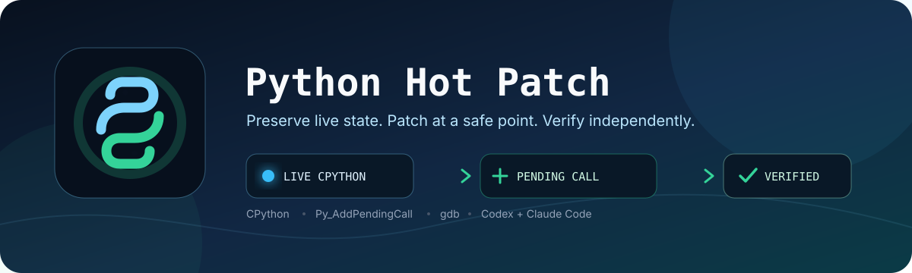
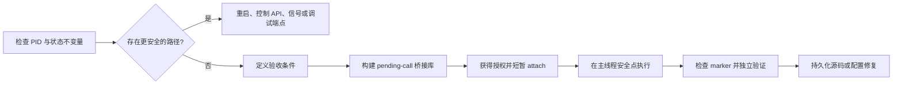

# Python Hot Patch Skill

<p align="center">
  
</p>

<p align="center">
  
  
  
  
  
</p>

<p align="center">
  <a href="./README.md">English</a> · <a href="./README_zh.md">简体中文</a>
</p>

一个面向 Codex 和 Claude Code 的通用 Agent Skill，用于指导智能体**安全地热修补正在运行的 CPython 进程**。它适用于无法轻易重启、需要保留昂贵内存状态，并且变更能够收敛为小范围 Python 对象或方法修改的场景。

该 skill 采用 `gdb`、临时共享库和 `Py_AddPendingCall`：调试器只负责将回调加入待处理队列，真正的 Python 修改在解释器主线程到达安全点后执行。

| 保留状态 | 安排执行 | 独立验证 | 持久化修复 |
|:--|:--|:--|:--|
| 保留昂贵的内存状态 | 通过 `Py_AddPendingCall` 安排 Python 工作 | 不依赖 marker，独立检查应用行为 | 同步修改源码或配置 |

## 工作原理



## 适用场景

- 重启会丢失代价高昂的内存状态。
- 修改目标明确，且可以表达为现有 Python 对象或方法的小范围变更。
- 可以在操作前定义并独立验证进程存活、语义状态、吞吐量或并发度等验收条件。
- 热修补完成后，能够同步修改磁盘上的源码或配置，避免下次重启回退。

以下情况应优先重启，或使用正式控制接口、信号处理器和已有调试端点：

- 修改解释器内部、对象布局或原生扩展状态。
- 修改模型结构、优化器状态或跨线程不变量。
- 无法唯一识别目标对象、确认旧状态或可靠验证结果。

## 核心安全约束

> [!CAUTION]
> 热修补是最后手段。只要重启或正式控制接口可用，就应优先使用更安全的方案。

- 每次附加进程前必须获得明确授权。
- 不得从任意暂停线程直接调用 `PyRun_SimpleString`，否则可能因线程未持有 GIL 而死锁或破坏解释器状态。
- 补丁必须具备幂等保护，并记录包含旧值和新值的 marker。
- `Py_AddPendingCall` 返回 `0` 只表示成功排队，不代表补丁已经执行。
- 回调结果未知时只等待 marker 或进程退出，不得重复附加或再次入队。
- marker 之外还必须独立验证应用行为、错误日志和资源使用情况。

完整操作规范见 [`SKILL.md`](./SKILL.md)。

## 兼容性

核心 `SKILL.md` 使用 Codex 与 Claude Code 共同支持的可移植 Agent Skills 格式。平台专属的界面元数据单独放在 `agents/` 中，不影响核心工作流。

## 安装

克隆仓库后，将它链接到一个或两个个人 skill 目录：

```bash
# Codex
mkdir -p ~/.agents/skills
ln -s /path/to/python-hot-patch-skill ~/.agents/skills/python-hot-patch

# Claude Code
mkdir -p ~/.claude/skills
ln -s /path/to/python-hot-patch-skill ~/.claude/skills/python-hot-patch
```

刷新会话后，两个智能体都可以根据任务描述自动匹配该 skill。Codex 中使用 `$python-hot-patch` 显式调用，Claude Code 中使用 `/python-hot-patch` 显式调用。

## 使用示例

```text
检查 PID 12345 的 asyncio 并发限制是否可以从 8 安全提高到 12。
使用 python-hot-patch skill，先制定验收标准并检查环境；实际 attach 前必须再次向我确认。
```

skill 会优先评估更安全的替代方案。只有满足安全边界时，才会准备临时共享库和待执行补丁；实际 `gdb attach` 仍需要即时授权。

## `asyncio.Semaphore` 特别说明

提高并发上限时，应在事件循环线程中对原有 semaphore 调用恰好 `new - old` 次 `release()`，同时更新其所属的限制字段。不要替换 semaphore 对象，因为已有 waiters 仍绑定在原对象上。

## 仓库结构

```text
.
├── assets/
│   └── hero.svg
├── README.md
├── README_zh.md
├── SKILL.md
└── agents/
    └── openai.yaml
```

- `SKILL.md`：Codex 和 Claude Code 加载的可移植工作流与安全边界。
- `agents/openai.yaml`：Codex 使用的可选界面元数据。
- `assets/hero.svg`：README 使用的仓库内置插图。

## 维护原则

- 保持 skill 聚焦于小范围、可验证的 CPython 在线修改。
- 新增规则应来源于真实风险或已观察到的失败，不堆积泛化限制。
- 修改后运行 Codex `skill-creator` 提供的 `quick_validate.py` 校验 `SKILL.md`。
- 不在仓库中保存进程转储、生产凭证、临时共享库或带有敏感状态的 marker。
